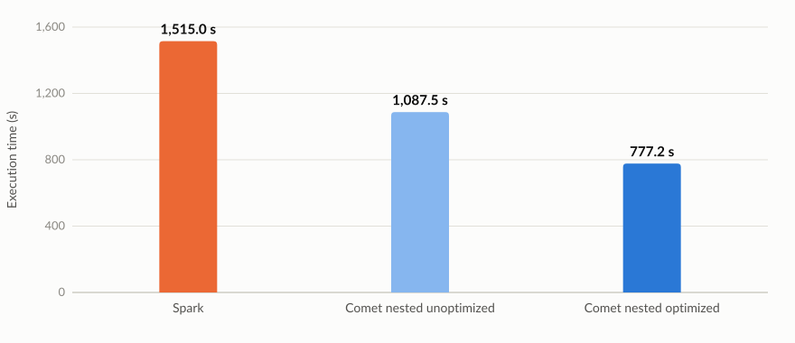
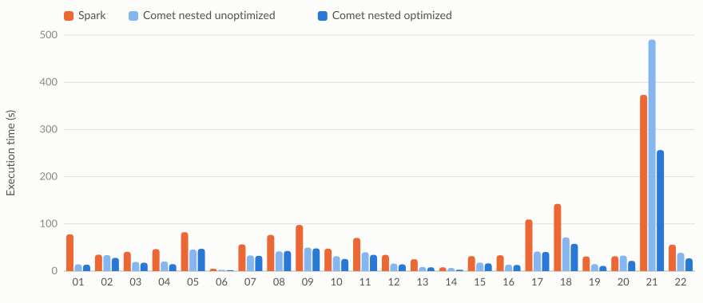

<!--

Licensed to the Apache Software Foundation (ASF) under one or more
contributor license agreements.  See the NOTICE file distributed with
this work for additional information regarding copyright ownership.
The ASF licenses this file to you under the Apache License, Version 2.0
(the "License"); you may not use this file except in compliance with
the License.  You may obtain a copy of the License at

http://www.apache.org/licenses/LICENSE-2.0

Unless required by applicable law or agreed to in writing, software
distributed under the License is distributed on an "AS IS" BASIS,
WITHOUT WARRANTIES OR CONDITIONS OF ANY KIND, either express or implied.
See the License for the specific language governing permissions and
limitations under the License.

-->

[TOC]

Query engines get fast at what their benchmarks measure, and the most widely used analytical benchmarks contain no nested data. Apache DataFusion Comet now runs all 22 queries of a nested TPC-H at scale factor 1000 (1 TB) in 777 s, against 1,515 s for Spark.



Nested TPC-H is a TPC-H derived benchmark in the Comet repository ([#7044](https://github.com/apache/datafusion-comet/pull/7044)). It keeps the TPC-H data and questions and changes only the shape of the tables. The data and queries are engine neutral, so they can be used to compare Spark, Comet and other engines.

We built it because our benchmarks and our users disagreed. Comet tracked its performance with TPC-H and TPC-DS, and the numbers were encouraging. Real user pipelines showed smaller gains, or none at all. What those pipelines had in common was nested data, which neither benchmark contains.

So we started experimenting with nested benchmarks in Comet to see where the gaps were. The first runs showed them: some queries ran slower on Comet than on Spark, even though Comet accelerates the same queries on flat TPC-H.

## Why: TPC-H is flat, real data is not

[TPC-H](https://www.tpc.org/tpch/) is one of the most cited analytical benchmarks, and its schema is flat: eight normalized tables with primitive columns. Its 22 queries exercise well-understood choke points such as aggregation, join ordering and correlated subqueries (Boncz, Neumann and Erling, "TPC-H Analyzed", TPCTC 2013).

Real data is often nested. Event logs, JSON, Avro and Protobuf records, and many data lake tables are full of structs and arrays, which Parquet stores with the record shredding scheme from Dremel (Melnik et al., VLDB 2010). Nested data adds work that flat benchmarks never exercise:

- **Reading.** Rebuilding list offsets and validity bitmaps from repetition and definition levels, and decoding only the fields a query uses.
- **Planning.** Nested column pruning and predicate pushdown through `explode`.
- **Operators.** `explode`, field access, and sort, join and exchange over wide variable-size values.
- **Memory and spilling.** Variable-size values make memory use and spill volume harder to predict.
- **Conversion.** Moving nested values between a JVM and a native representation.

Comet hit the shuffle case in [#5397](https://github.com/apache/datafusion-comet/issues/5397), where native shuffle writes of wide nested fields were two to three times slower than Spark's. The issue notes that it was "invisible for TPC-* benchmarks because of historical flat schema".

We needed a benchmark that fills the gap between academic benchmarking and real user workloads.

## How: an adapter that nests TPC-H

We did not want to invent a new benchmark from scratch. TPC-H is well understood, widely published and easy to generate, and its business shape (customers, orders, line items, suppliers and parts) is what makes its results meaningful. The goal was to preserve that shape and those questions while making every query process nested data.

The idea turned out to be surprisingly simple: a transformation of both the data and the queries that leaves the key and partition columns at the top level and nests everything else. The partition columns are `p_brand`, `c_mktsegment`, `o_orderdate` and `l_shipdate`, and every other non-key column moves into one `array<struct>` named `<table>_data`. Each array holds exactly one element, so exploding it never changes the row count and the queries return the same answers as TPC-H. For `lineitem`:

```
-- flat                               -- nested
l_orderkey       BIGINT               l_orderkey     BIGINT
l_partkey        BIGINT               l_partkey      BIGINT
l_suppkey        BIGINT               l_suppkey      BIGINT
l_linenumber     INT                  l_shipdate     DATE        -- partition column
l_quantity       DECIMAL(12,2)        lineitem_data  ARRAY<STRUCT<
l_extendedprice  DECIMAL(12,2)            l_linenumber: INT,
l_discount       DECIMAL(12,2)            l_quantity: DECIMAL(12,2),
l_tax            DECIMAL(12,2)            l_extendedprice: DECIMAL(12,2),
l_returnflag     STRING                   l_discount: DECIMAL(12,2),
l_linestatus     STRING                   l_tax: DECIMAL(12,2),
l_shipdate       DATE                     l_returnflag: STRING,
l_commitdate     DATE                     l_linestatus: STRING,
l_receiptdate    DATE                     l_commitdate: DATE,
l_shipinstruct   STRING                   l_receiptdate: DATE,
l_shipmode       STRING                   l_shipinstruct: STRING,
l_comment        STRING                   l_shipmode: STRING,
                                          l_comment: STRING>>
```

Each of the 22 queries is rewritten to unnest only the arrays it needs. The queries are in [`benchmarks/nested/queries`](https://github.com/apache/datafusion-comet/tree/main/benchmarks/nested/queries).

```sql
from (select l_orderkey, l_partkey, l_suppkey, l_shipdate,
             explode(lineitem_data) as lineitem_data from lineitem) as lineitem
where lineitem_data.l_quantity < 24
```

[`nest_tpch.scala`](https://github.com/apache/datafusion-comet/blob/main/benchmarks/nested/scripts/nest_tpch.scala) converts an existing flat TPC-H dataset to the nested layout. The source and the target can each be Parquet or Iceberg. The script runs under `spark-shell` on a laptop or a cluster, casts columns to fixed types, writes zstd-compressed Parquet with 512 MiB row groups, partitions by the columns above and checks row counts:

```bash
spark-shell -i scripts/nest_tpch.scala \
  --conf spark.nesttpch.source=parquet:/data/tpch/sf10 \
  --conf spark.nesttpch.target=parquet:/data/tpch-nested/sf10
```

The [README](https://github.com/apache/datafusion-comet/tree/main/benchmarks/nested) has the Iceberg variants and all settings.

## Benchmark setup

- **Data**: nested TPC-H, scale factor 1000 (1 TB).
- **Tables**: Apache Iceberg tables with zstd-compressed Parquet data files on S3, created with `nest_tpch.scala`. Comet reads them with its native Iceberg scan, which is built on [iceberg-rust](https://github.com/apache/iceberg-rust).
- **Cluster**: Kubernetes with 16-core executors.
- **Method**: one run per configuration, three iterations per query. Figures are the fastest iteration, and totals are sums of the per-query times.
- **Spark**: Spark 4.0
- **Comet nested unoptimized**: Comet 1.1.0 snapshot (revision `a50fe3aea863`)
- **Comet nested optimized**: Comet 1.3.0 snapshot (revision `330b29cf`)

## What nested benchmarks revealed

The nested benchmark exposed issues that were invisible on flat TPC-H. In the unoptimized run, Comet was slower than Spark on q20 (32.9 s against 31.5 s) and q21 (490.6 s against 373.5 s), and barely faster on q02 (34.0 s against 34.9 s). Tracing those queries surfaced a lot of technical debt in how nested data is read, shuffled and spilled, in Comet and in the iceberg-rust reader underneath it.

The issues fell into four groups:

- **Spilling.** Wide nested values made q21's sort spill several hundred GiB per iteration, and Comet wrote spill files uncompressed.
- **Reading only what a query needs.** Comet's native Iceberg scan decoded every field of a nested column, even when Spark had pruned it to one field. This is why q20 was no faster than Spark.
- **Shuffle.** Native shuffle wrote wide nested fields two to three times slower than Spark.
- **Nested reads in iceberg-rust.** Nested fields read as NULL, some list types could not be read at all, and projection cost grew with the number of nested leaves.

Spills and shuffle writes happen in flat workloads too. The nested schema changed the data volume or access pattern enough to expose them.

Most of these issues are fixed. The issues and pull requests, with their measurements, are listed in [Issues and pull requests](#issues-and-pull-requests) at the end of the post.

## Results

### Total execution time

Unoptimized Comet takes `1,087.5` s against `1,515.0` s for Spark (1.39x) and is slower on q20 and q21. Optimized Comet takes `777.2` s (1.95x), 29% less than unoptimized, and is faster than Spark on all 22 queries.


### Execution time by query

q21 is the longest query: 490.6 s on unoptimized Comet, 373.5 s on Spark and 256.6 s on optimized Comet.



| Query | Spark (s) | Comet unoptimized (s) | Comet optimized (s) |
| ----- | ---: | ---: | ---: |
| q01 | 78.1 | 14.5 | 13.7 |
| q02 | 34.9 | 34.0 | 28.1 |
| q03 | 41.0 | 19.6 | 17.9 |
| q04 | 46.7 | 20.6 | 14.8 |
| q05 | 82.5 | 45.7 | 47.4 |
| q06 | 4.9 | 2.8 | 1.9 |
| q07 | 56.7 | 33.3 | 32.4 |
| q08 | 76.8 | 42.0 | 42.8 |
| q09 | 97.9 | 49.9 | 48.1 |
| q10 | 47.7 | 31.6 | 25.8 |
| q11 | 70.4 | 40.0 | 34.5 |
| q12 | 34.4 | 16.1 | 14.4 |
| q13 | 25.3 | 8.7 | 8.1 |
| q14 | 8.2 | 6.8 | 2.8 |
| q15 | 31.8 | 18.1 | 16.5 |
| q16 | 33.7 | 13.7 | 13.1 |
| q17 | 109.4 | 41.5 | 40.6 |
| q18 | 142.5 | 71.6 | 57.9 |
| q19 | 31.2 | 14.8 | 11.0 |
| q20 | 31.5 | 32.9 | 21.8 |
| q21 | 373.5 | 490.6 | 256.6 |
| q22 | 56.1 | 38.8 | 27.1 |
| **Total** | **1,515.0** | **1,087.5** | **777.2** |

## What's next

- **Nested TPC-DS**, with the same rule: keys and partition columns stay at the top level, the rest moves into a single-element `array<struct>`. Open questions are which columns count as keys (surrogate keys end in `_sk` and many are nullable), which columns to partition by, and how to rewrite `ROLLUP` and window queries next to `explode`.
- **Other nested shapes**: multi-element arrays, maps and deeper nesting, at the cost of changing the questions the queries answer.
- **More engines**: results for other engines on the same data.

## Issues and pull requests

Each item links to the pull request that fixed it, or to the open pull request or issue that tracks it.

### In Comet

- **q21 spills uncompressed ([#6467](https://github.com/apache/datafusion-comet/issues/6467), fixed by [#6698](https://github.com/apache/datafusion-comet/pull/6698)).** Spark pushes the `EXISTS` and `NOT EXISTS` predicates below the `explode`, so the whole unpruned `lineitem_data` column goes through the shuffle, sort and joins. The sort spilled several hundred GiB per iteration, and DataFusion writes spill files uncompressed by default. #6698 adds `spark.comet.exec.spill.compression.codec`, which defaults to `lz4`. This is behind q21's regression in the results above. The investigation in #6467 used a separate run on Spark 4, where q21 went from 380 s to 250 s against 367 s for Spark.
- **Nested columns are read in full ([#6724](https://github.com/apache/datafusion-comet/issues/6724), fixed by [#6725](https://github.com/apache/datafusion-comet/pull/6725)).** Comet's native Iceberg scan decoded every field of a nested column even when Spark pruned it. In q20 the `partsupp` scan read 26.4 GiB for a query that needs one field, and #6724 found that scan to be the main cost of Comet's q20. This is why q20 was no faster than Spark in the unoptimized run. #6725 passes the pruned schema, and a microbenchmark of that read went from 624 ms to 62 ms, against 413 ms for Spark. The follow-up [#7019](https://github.com/apache/datafusion-comet/issues/7019) covers a partition column nested inside a pruned struct.
- **Nested shuffle writes ([#5397](https://github.com/apache/datafusion-comet/issues/5397)).** The motivating issue above. Related work is tracked in [#6855](https://github.com/apache/datafusion-comet/issues/6855).

### In iceberg-rust

Comet's native Iceberg scan reads data files through iceberg-rust's Arrow reader, so the work on nested reads continued there.

- **Nested fields of migrated files read as NULL ([apache/iceberg-rust#3374](https://github.com/apache/iceberg-rust/issues/3374), fixed by [#3384](https://github.com/apache/iceberg-rust/pull/3384)).** For data files without embedded field IDs, the reader applied the table's name mapping to top-level columns only. Fields inside a struct, list or map got no ID, so the projection never selected them. #3384 applies the mapping at every depth, as Iceberg Java does.
- **Projection mask cost grows with the number of leaves ([#3394](https://github.com/apache/iceberg-rust/issues/3394), fixed by [#3396](https://github.com/apache/iceberg-rust/pull/3396)).** The reader built a projection mask for every file scan task and hashed every Arrow leaf twice to do it. Nested columns add leaves, so this cost grows with the schema. For a file with 1,000 columns and 10 projected, one call went from 318 µs and 3,976 allocations to 95 µs and 178 allocations.
- **List view columns read as NULL ([#3393](https://github.com/apache/iceberg-rust/issues/3393), fix in review in [#3467](https://github.com/apache/iceberg-rust/pull/3467)).** When a file's embedded Arrow schema asks for `ListView`, the projection treats the whole list as one leaf. The column reads as NULL, and a list view of structs shifts every later column to the wrong Parquet leaf. #3467 reads list views as lists.
- **Fixed-size list columns fail to read ([#3471](https://github.com/apache/iceberg-rust/issues/3471), open).** This is the same kind of problem for `FixedSizeList`. The reader cannot convert it to Iceberg's `list` type.

## Credits

Issues, pull requests and results from other engines and scale factors are welcome. See the [Comet contributor guide](https://datafusion.apache.org/comet/contributor-guide/index.html).

TPC-H is a trademark of the TPC. The queries are derived from TPC-H under the TPC Fair Use Policy, and results from them are not TPC-H results.
